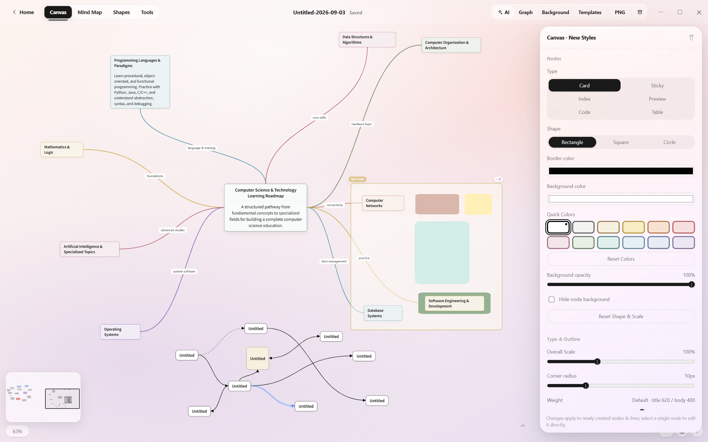
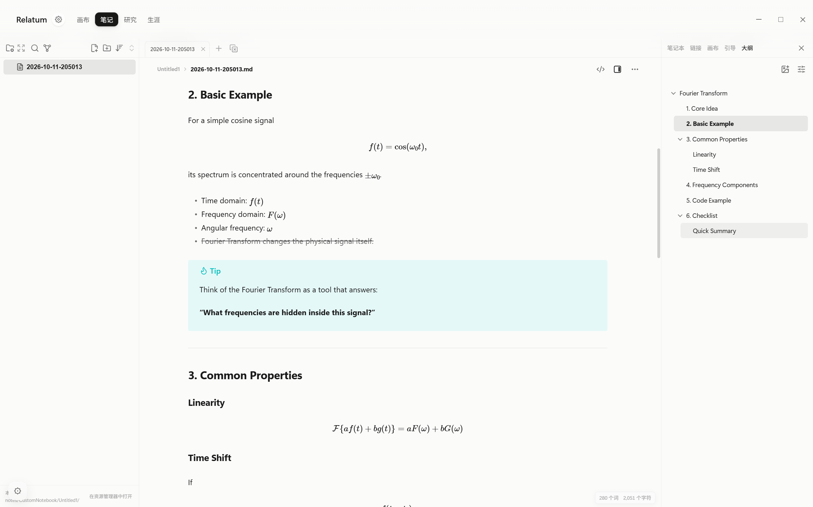
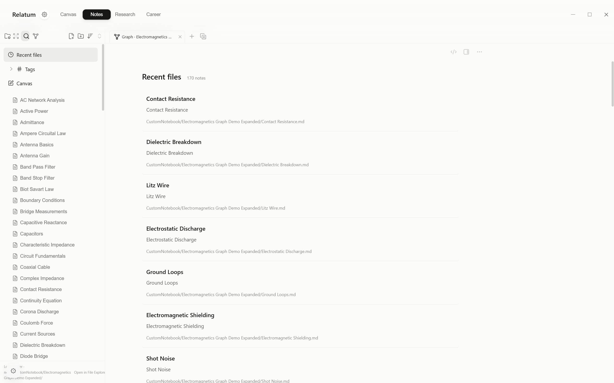
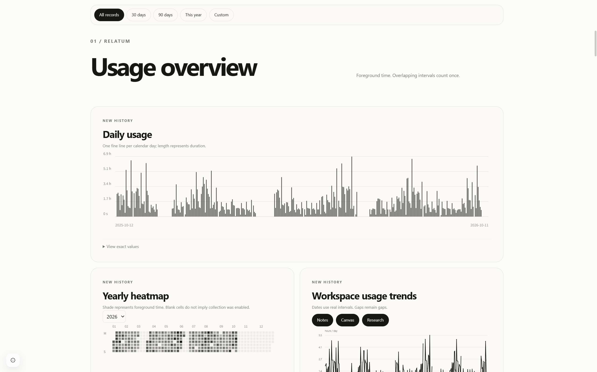
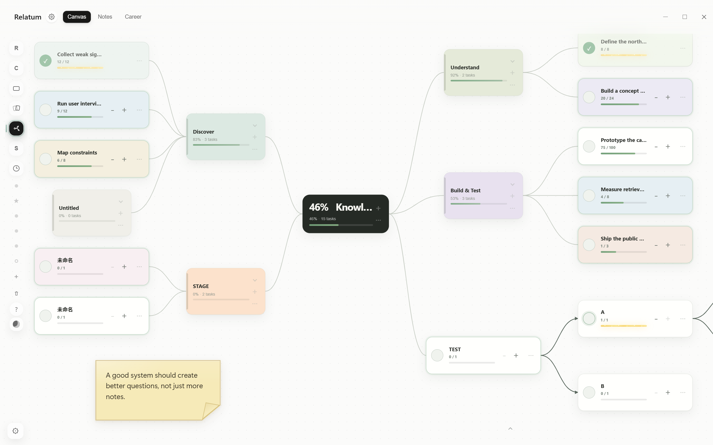
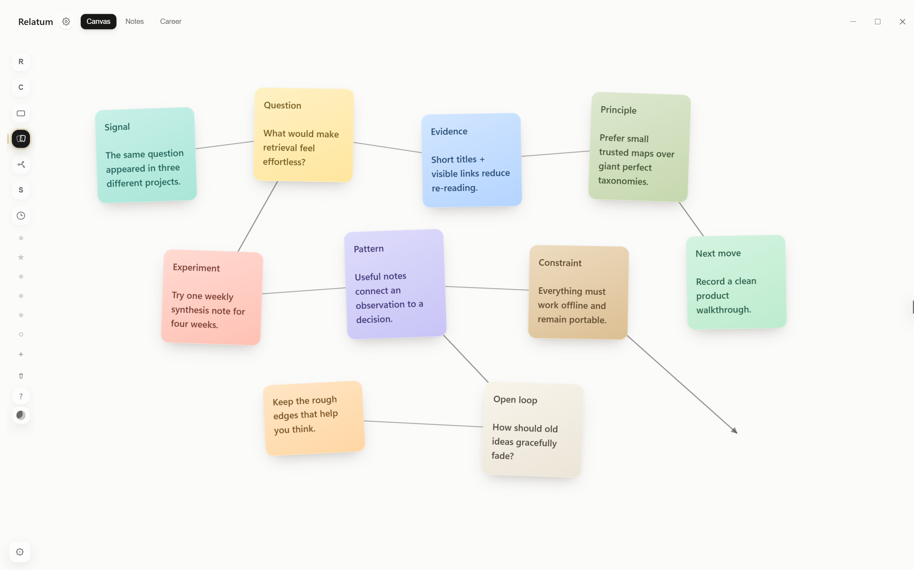
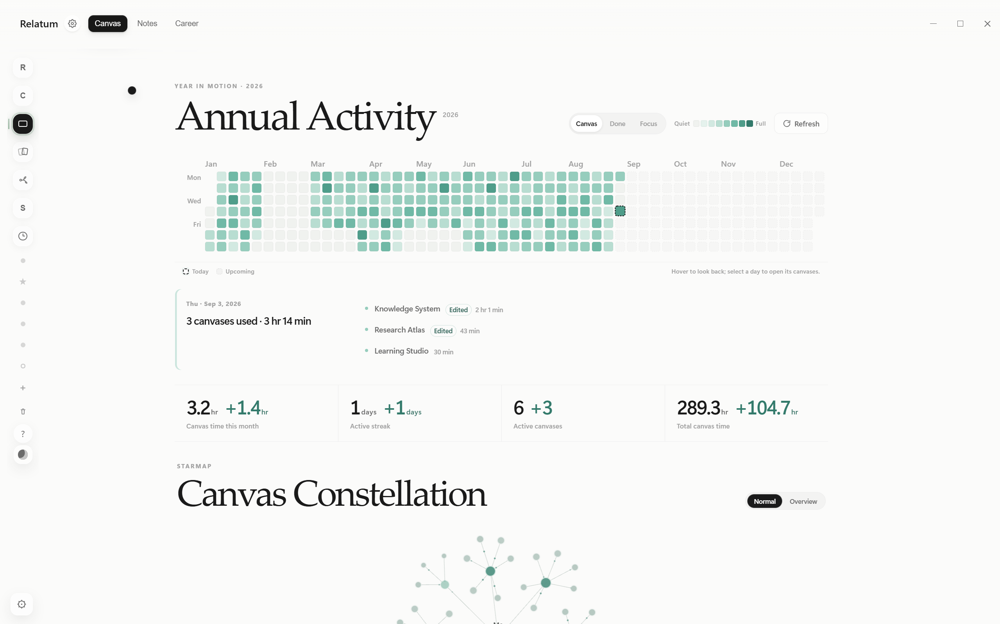
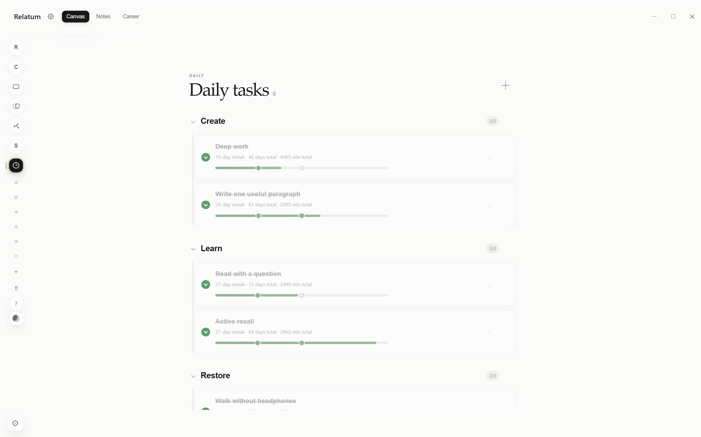
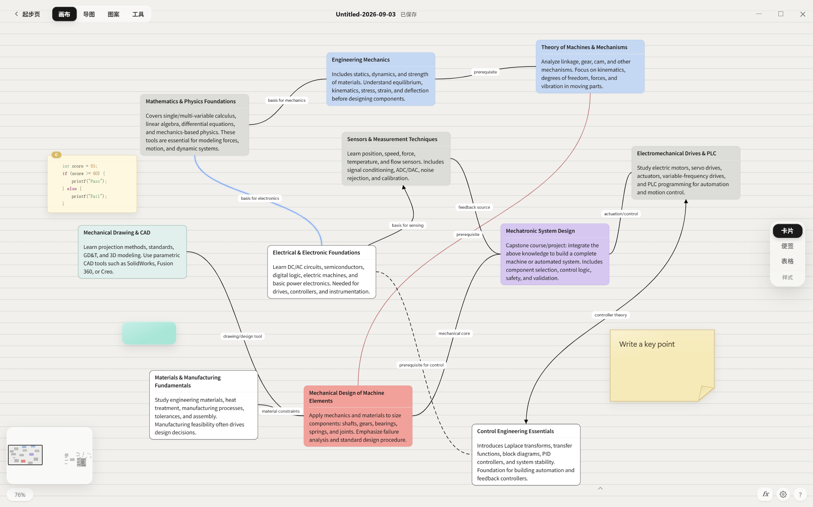
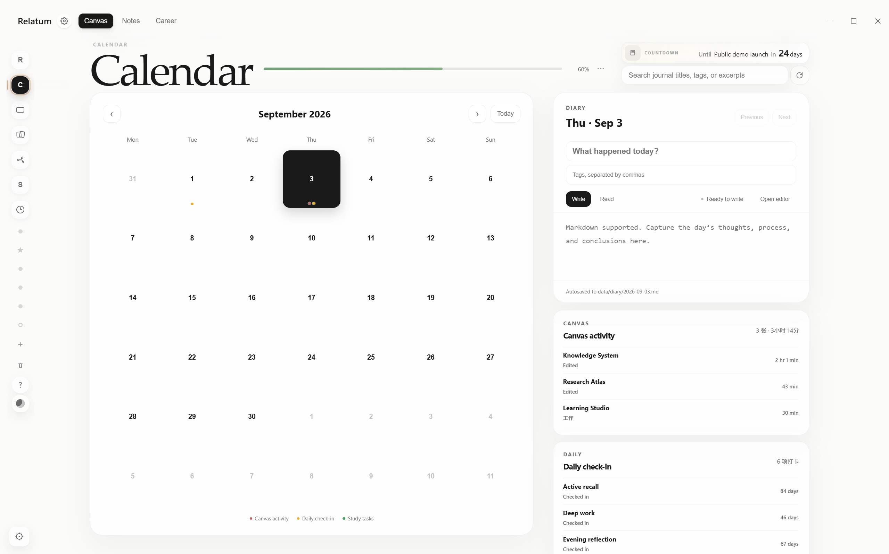

# Relatum

<p align="center">
  <strong>本地画布、Markdown 笔记和学习工具。</strong>
</p>

<p align="center">
  开源、本地优先的 Windows 知识画布与学习笔记软件<br>
  适合视觉笔记、个人知识管理（PKM）、课程整理、研究构思与思维导图<br>
  界面语言：简体中文 · English
</p>

<p align="center">
  <a href="README_EN.md">English</a> ·
  <a href="https://github.com/yamibk/Relatum/releases/latest/download/Relatum-release.zip"><strong>下载 Windows 版</strong></a> ·
  <a href="https://github.com/yamibk/Relatum/releases/latest">查看最新版本</a> ·
  <a href="CONTRIBUTING.md">参与贡献</a>
</p>

<p align="center">
  <a href="https://github.com/yamibk/Relatum/releases/latest"></a>
  <a href="LICENSE"></a>
  
  
</p>

<p align="center">
  <a href="https://github.com/yamibk/Relatum/releases/latest">
    
  </a>
</p>

## Relatum 是什么？

Relatum 是一款开源的 Windows 本地软件，提供画布、笔记、研究和生涯四个工作区。

无需注册账号，笔记、画布和设置保存在本机。主要功能可离线使用，AI 助手按需连接用户配置的服务。

## 核心能力

### 画布

- 在无限画布上添加文字、图片、代码和附件，自由移动和连线。
- 调整节点和连线样式，支持手写、一键思维导图排版和 PNG 导出。
- 基础兼容 Obsidian Canvas 格式。

### 笔记

- Markdown 实时渲染，支持公式、代码、Callout、图片和内嵌画布。
- 用笔记本、文件夹和多标签页管理文件，编辑时自动保存。
- 通过搜索、最近文件、标签、大纲、双链和关系图谱查找与浏览笔记。

### 阅读与资料

- 阅读 PDF 和 Markdown，添加批注。
- 支持公式、Mermaid 图表和本地附件，可导入 Markdown 文件夹。

### 学习与生涯

- 提供学习任务、每日任务、番茄钟和正计时。
- 支持日历日记、倒数日、速记墙和复习卡片。
- 生涯工作区展示每日使用时长、年度热力图和各工作区的使用趋势，可按时间范围查看。

### 外观与 AI

- 支持主题、自定义背景、模板和样式预设。
- 可选 AI 助手支持对话、整理内容和生成画布；API 地址、模型和 Key 由用户配置。

## 界面预览

### 笔记：Markdown 实时渲染

编辑时直接显示公式、列表和 Callout，右侧大纲可快速跳转章节。



### 笔记：浏览与查询

通过最近文件、标签和搜索找到笔记，列表显示标题、摘要和文件路径。



### 生涯：使用统计

查看每日使用时长、年度热力图和工作区使用趋势，支持全部记录、最近 30 天、90 天、本年和自定义范围。



### 其他界面

<table>
  <tr>
    <td width="50%">
      
      <p align="center">独立目标树与渐进任务</p>
    </td>
    <td width="50%">
      
      <p align="center">速记墙与视觉关系线</p>
    </td>
  </tr>
  <tr>
    <td width="50%">
      
      <p align="center">年度活跃统计与画布星图</p>
    </td>
    <td width="50%">
      
      <p align="center">每日任务、连续记录与里程碑</p>
    </td>
  </tr>
  <tr>
    <td width="50%">
      
      <p align="center">自由画布与课程知识图谱</p>
    </td>
    <td width="50%">
      
      <p align="center">日历、日记、倒数日与每日记录</p>
    </td>
  </tr>
</table>

## 快速开始

### 下载 Windows 桌面版

1. [下载最新版 `Relatum-release.zip`](https://github.com/yamibk/Relatum/releases/latest/download/Relatum-release.zip)。
2. 将 ZIP 完整解压到一个可写目录。
3. 双击彩色图标的 `Relatum.exe` 进入完整模式，或双击黑白灰图标的 `RelatumLauncher.exe` 选择本次功能后启动。

支持 Windows 10/11。目标电脑需要 Microsoft Edge WebView2 Runtime，Windows 10/11 通常已经安装。

> 请不要在旧版本目录中直接覆盖更新。建议先保留旧目录中的 `data/`、`canvases/` 和 `notes/`，确认新版正常后再迁移个人数据。

### 使用资源选择启动器

`RelatumLauncher.exe` 提供 16 个开关：四个工作区、画布管理、画布编辑器、七个特殊页面，以及 AI、图谱和动态桌面背景。关闭父项会保留子项的勾选记忆，本次不加载它们。选择在点击“启动 Relatum”时原子保存到应用数据目录的 `data/launcher-profile.json`（版本 1）；取消不保存。配置损坏会提示并显示默认选择，新增功能默认启用。

默认每次打开启动器都等待用户确认。在 Relatum 的“客户端设置”中勾选“启动 RelatumLauncher 时不再弹窗”，之后双击启动器会直接按上次选择启动；取消勾选即可恢复选择窗口。此偏好独立原子保存到 `data/launcher-settings.json`（`{version:1, skipSelection:布尔值}`），不会改动功能选择。选择配置缺失或损坏时仍显示选择窗口。仅编辑器模式会复用上次确认的画布路径；文件失效时恢复选择窗口。

免弹窗时主窗口直接在启动器当前进程运行，任务管理器显示 `RelatumLauncher.exe`，省去再次启动主 EXE 的等待；手动确认仍打开 `Relatum.exe`。两种方式共用功能限制、单实例和关闭保存流程。

启动器不会因为仅启用一个工作区而自动隐藏顶栏。笔记继续通过现有专注按钮开关并记忆个人偏好；生涯沿用已有顶部感应展开机制。

禁用功能不会加载脚本、初始化或预热，入口、翻页、快捷键和专属写入接口也会被限制；已启用功能保留原有预热，历史统计仍可读取其他功能的数据。发布包保留全部资源，选择只影响本次运行，禁用不会删除用户内容。

画布管理和编辑器可以分别选择。如果只保留编辑器，启动前必须选择现有 `.canvas`。已有 Relatum 主窗口时，请先退出；启动器保留当前选择并提示。直接运行 `Relatum.exe` 不读取启动器的配置；已有精简模式窗口时会提示先退出，再进入完整模式。

### 从源码运行

需要 Windows 10/11 与 Python 3.9 或更高版本。源码模式只依赖 Python 标准库：

```powershell
python app.py
```

也可以双击 `打开画布.bat`，或运行：

```powershell
powershell -ExecutionPolicy Bypass -File .\start.ps1
```

首次启动后会在应用目录创建：

- `canvases/`：用户的 `.canvas` 文件及附件。
- `notes/`：笔记工作区的 `.md` 文件、子文件夹及本地图片。
- `data/`：最近列表、学习记录、日历、窗口状态和 AI 配置等本地数据。

这三个目录已被 `.gitignore` 排除，不会进入源码仓库。完整数据边界请阅读 [隐私说明](docs/PRIVACY.md)。

## 构建 Windows 桌面版

首次使用双击 `Relatum-维护工具/准备Relatum构建环境.bat`，需要联网。以后双击 `构建Relatum-release.bat`，日常打包不联网。简短操作说明见 [打包新手说明](Relatum-维护工具/打包新手说明.md)。

构建使用 `%LOCALAPPDATA%/RelatumBuild` 下独立固定的 Windows x64 Python 3.12.15，不依赖系统 Python 或 Codex。运行时和全部桌面依赖的版本、下载地址及 SHA-256 固定在 `packaging/desktop-build-lock.json`；安装包保留在缓存中，`离线修复Relatum构建环境.bat` 可在缓存完整时离线修复。环境检查包含依赖导入、版本、`pip check` 和 SQLite ≥3.43 的 FTS5/短字符查询。

命令行入口（普通使用不需要输入）：

```powershell
powershell -ExecutionPolicy Bypass -File .\build-desktop.ps1
```

输出位于项目同级的 `Relatum-release/`，包含彩色图标的 `Relatum.exe`、黑白灰图标的 `RelatumLauncher.exe`、各自的 `.exe.config` 和共用 `_internal/`。启动器保留相同节点连线图案，选择窗口也使用灰阶图标；主窗口与托盘仍使用主程序图标。请分发整个目录。构建脚本不会把 `data/`、`canvases/` 或 `notes/` 打进发布包。

环境缺失时打包立即停止，不自动安装；通过 `prepare-desktop.ps1` 显式准备，`-Offline` 只读缓存。`build-desktop.ps1 -CheckOnly` 只检查环境，旧 `-SkipInstall` 参数仍可使用。`-OutputDirectory` 指定独立产物目录，`-KeepBuildArtifacts` 保留本次暂存内容。日志保存在构建环境的 `logs/`，可双击维护工具中的日志入口打开。环境准备和打包互斥，新产物完整验证后才替换旧目录，替换失败回滚；默认拒绝覆盖含用户数据的旧目录。显式 `-ForceReplaceUserData` 也会保留含数据的旧目录备份，不直接删除。

### 构建 Microsoft Store 包

先安装 Windows 10/11 SDK（需要其中的 `MakeAppx.exe`），然后运行：

```powershell
powershell -ExecutionPolicy Bypass -File .\build-msix.ps1
```

输出位于项目同级的 `Relatum-store/`。向合作伙伴中心上传其中的
`Relatum_<版本>_x64.msixupload`。商店安装版把画布和设置保存在
`%LOCALAPPDATA%\Relatum`；源码模式和 GitHub 便携版的数据位置保持不变。
此次启动器只用于便携版；MSIX 暂存包会排除启动器 EXE 和它的 `.exe.config`。

## 项目结构

```text
Relatum/
├─ app.py                    本地 HTTP 服务与数据 API
├─ notes_library.py          Markdown 文件操作、素材与路径安全层
├─ notes_index.py            独立 SQLite 笔记索引、查询与清理
├─ notes_sync.py             后台增量同步与目录变化通知
├─ note_search.py            连续字符检索与源码位置映射
├─ desktop.py                Windows 桌面外壳
├─ launcher.py               原生 WinForms 资源选择窗口
├─ feature_profile.py        功能依赖、会话配置与加载/访问边界
├─ windows_wallpaper.py      隔离的倒数日动态背景子进程、WorkerW 挂载与托盘生命周期
├─ assets/                   HTML、CSS、JavaScript 与运行资源
├─ packaging/                图标、字体和桌面构建辅助工具
├─ build-desktop.ps1         Windows 便携发布包构建入口
├─ build-msix.ps1            Microsoft Store MSIX 构建入口
├─ start.ps1                 源码模式启动入口
├─ AI笔记创作指南.md          外部准备画布/Markdown 笔记的参考（非运行时依赖）
└─ AGENTS.md                 架构约束与维护说明
```

## 开发与验证

启动器验证使用一次性 `RELATUM_DATA_ROOT`，不会读取真实用户库。安装桌面构建依赖后运行：

```powershell
python -m unittest tests.test_feature_profile tests.test_launcher_native tests.test_desktop_instance tests.test_windows_wallpaper tests.test_runtime_paths
node tests/feature-profile-browser.js
node tests/launcher-settings-package.js <发布目录>
node tests/launcher-entry-package.js <发布目录>
node tests/launcher-startup-package.js <发布目录> <启动报告JSON路径> 5
node tests/launcher-package-memory.js <发布目录> <报告JSON路径> 3
```

浏览器验证使用本机已有 Playwright 和 Edge：`RELATUM_PLAYWRIGHT` 指定 Playwright 模块绝对路径，`RELATUM_EDGE_PATH` 指定 Edge EXE，`RELATUM_PYTHON` 指定 Python。打包验证直接连接实际 WebView2，覆盖普通单实例、笔记关闭保存和三次冷启动的进程树内存中位数。测量方法和结果见 [启动器验证说明](docs/launcher-verification.md)。

项目不需要 npm，也没有前端构建步骤。提交修改前至少运行：

```powershell
python -m py_compile app.py desktop.py windows_wallpaper.py packaging\make_icon.py packaging\make_launcher.py packaging\make_font_subset.py

Get-ChildItem assets -Recurse -Filter *.js |
  Where-Object { $_.FullName -notmatch '\\vendor\\' } |
  ForEach-Object { node --check $_.FullName }

powershell -ExecutionPolicy Bypass -File .\scripts\check-public.ps1
```

制作公开 ZIP 或正式发布前，再运行：

```powershell
powershell -ExecutionPolicy Bypass -File .\scripts\check-public.ps1 -Physical
```

## 参与贡献

问题反馈、功能建议、文档改进和代码贡献都欢迎。开始前请阅读 [CONTRIBUTING.md](CONTRIBUTING.md) 和 [AGENTS.md](AGENTS.md)。

## 第三方组件与许可证

仓库内置 Mermaid、MathJax、PDF.js 和若干字体，以便离线运行。许可证和归属见 [THIRD_PARTY_NOTICES.md](THIRD_PARTY_NOTICES.md)。

Relatum 的原创源代码和文档采用 [MIT License](LICENSE)，Copyright © 2026 yamibk。第三方组件、字体与媒体素材继续适用各自的许可范围。
