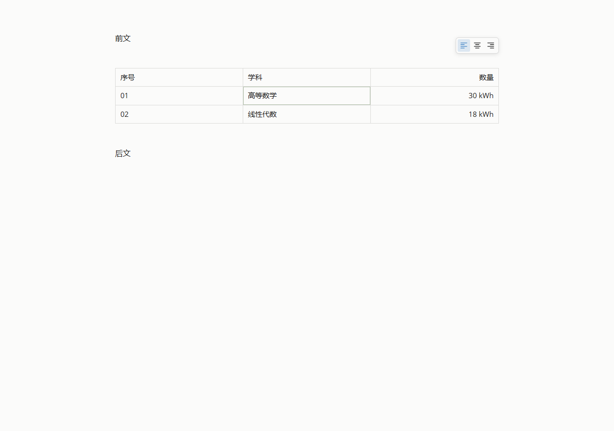

# 笔记表格对齐工具条 · 2026-10-22

当前表格提供浮动的左对齐、居中和右对齐按钮，有效正文宽度不足 480px 时收为“对齐”菜单。当前格对应整列；矩形选区对应覆盖列；整行或整表选区对应所有列。混合对齐不选中任何按钮，提示中说明目标范围。新表格默认左对齐，已有表格继续遵循 Markdown 冒号标记。

工具条不占正文高度，优先显示在表格上方，避开边缘手柄；空间不足时翻到下方或停靠正文视口上缘。退出格内编辑后按 Tab 可进入工具条，方向键切换、Enter 应用、Escape 返回表格；工具条焦点下的撤销重做仍使用同一编辑器历史。阅读模式不显示按钮，离开正文、隐藏或销毁时释放临时监听。

## 源码与输入

- 对齐只修改指定列的分隔标记，保留其他内容、空白、可选外侧竖线和连字符数量；一次独立撤销，同值不产生事务。表格首行继续保持普通字重。
- 复用已有表格事务通道，校验原模型、位置、操作身份和新分隔行。行数据共享，目标列仅更新对齐样式；格内 textarea 继承同一对齐，不重建 DOM 或移动原生输入宿主。
- 点击按钮保留原焦点与选区；候选期间排队，结束后应用，离开或最小化作废迟到操作。未增加公开 API、偏好或数据格式，不批量改写已有笔记。

## 验证

全部使用静态合成正文或一次性后端数据根，未修改实际笔记、附件或配置。

| 检查 | 结果 |
| --- | --- |
| `note-table-alignment-browser.js` | 当前列、多列、整行、整表、混合/重复设置、原文保留、撤销重做、真实鼠标、键盘、候选等待/取消交接、中英文/深浅、100%–200% 字号、窄窗菜单避让及生命周期通过 |
| 8000 格表格 | 8000 个单元格及其内容 DOM 不变，正常对齐零表格 parse 调用，局部事务只改目标列；闲置 500ms 零新增 RAF |
| `note-table-browser.js` | 原有表格输入、粘贴、格式、候选和重排通过，新增对齐保存、阅读及重开检查通过 |
| `note-table-interaction-browser.js` | 鼠标落点、行列重排、选区差集与滚动通过，4000 格无选区/已选区滚动零逐格属性写入 |
| `note-live-presentation-browser.js` | 正文投影、公式选区、Callout、源码往返及 4MiB 文档输入通过 |
| `note-input-browser.js` / `note-scroll-browser.js` | 输入格式、表格格式以及工作区往返、阅读/源码和非整数布局滚动稳定检查通过 |
| 静态回归 | Markdown、表格、紧凑表格契约、实时编辑器、笔记工作区契约、Typora 扩展语法通过 |

候选检查由真实 Edge 的 CDP 输入通道驱动，覆盖浏览器 composition 和原生 textarea 生命周期；本次没有重新进行桌面微软拼音候选窗人工验收。

[深色窄窗 200%](validation/note-table-alignment-2026-10-22/narrow-dark.png) · [专项报告](validation/note-table-alignment-2026-10-22/report.json)

浏览器检查沿用 `RELATUM_PLAYWRIGHT`、`RELATUM_EDGE_PATH` 和 `RELATUM_PYTHON`；专项脚本只依赖前两个变量。截图、报告由专项脚本生成在系统临时目录，选取合成样例随本文保存。
