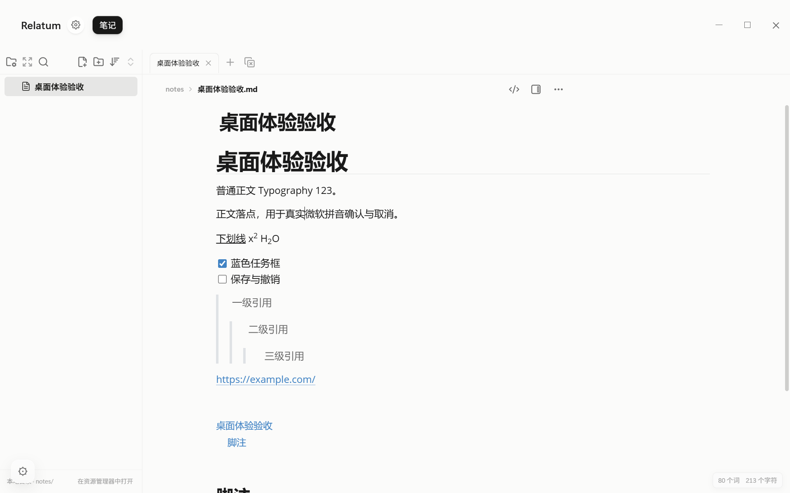

# 笔记正文体验升级与验收 · 2026-10-22

本轮升级默认正文体验，参考本机 Typora 1.14.10 的 GitHub 主题。保留 Relatum 的文件树、标签、多栏、双链、Callout、图片文字、表格及内嵌画布。独立文件名大标题始终保留，不自动隐藏同名 Markdown 标题。

## 呈现与编辑

- 正文默认 16px / 1.6，H1–H6 为 2.25/1.75/1.5/1.25/1/1em；默认最大行宽 800px，在足够宽的容器内扩为 964/1140px。正文左边距为 `clamp(42px, 6vw, 112px)`、右边距为 `clamp(22px, 3vw, 48px)`，标题、实时编辑、源码和阅读共用，右栏开合时左侧起点固定，空间不足仍正常换行；手机窄屏沿用原边距。既有字号百分比继续有效。本次边距修复仅审阅修改差异，按用户要求未运行测试、浏览器验证或构建；下文验收记录属于此前升级。
- 西文使用本地 Open Sans v17，中文优先微软雅黑；常规、粗体、斜体、粗斜体均为离线资源，许可随字体附带。仅为缺少原生斜体的回退字体允许斜体合成，不使用描边或滤镜锐化。
- 链接、任务框及正文选区为蓝色，深色使用较亮蓝色。实时编辑的空行和连续空行保留完整正文行高，默认 25.6px，回车后输入首字不再改变其基线。源文件空行不变，源码模式保留真实行结构。
- 标题和列表标记只在相应结构前缀处显露；引用按真实深度显示连续边线，代码中的引用前缀与真正的 `>` 运算符分开处理。保留既有列表续写、Tab/Shift+Tab、空列表/空引用退出和父编辑器撤销。


[升级前截图](validation/note-typora-2026-10-22/visual/before-light.png) · [参考主题截图](validation/note-typora-2026-10-22/visual/reference-theme.png) · [深色窄窗 200%](validation/note-typora-2026-10-22/visual/after-dark-620-2.png)

“参考主题截图”是相同合成内容应用本机 Typora GitHub CSS 的排版参照，不是 Typora 程序的编辑器截图；正文截图不包含独立文件名标题。真实 Relatum 桌面截图见下文。

## 语法与数据边界

`MarkdownMini.renderResult(source, {noteSyntax:true})` 显式开启扩展。默认共享 Markdown 不改变。笔记编辑、阅读、单元格及引导预览使用同一识别器。

- 自动识别 HTTP(S)、www、邮箱和尖括号链接，处理中文标点、尾随标点及括号平衡。普通点击编辑，Ctrl/Cmd 点击打开，沿用已有外部 URL 和库内路径授权。
- 参考式链接支持 `[标题][id]`、`[id][]`、`[id]`，以及目标与标题定义；定义变化同步到正文和依赖它的单元格，未变化单元格 DOM 保持复用。
- 脚注支持定义、缩进续行、首次引用编号、重复引用共号、跳转与返回；缺失定义保持源文本。表格内脚注使用正文定义与父编辑器 UTF-16 位置，不生成重复脚注区。
- 独占一行的 `[TOC]` 使用现有正文标题索引，不包含文件名标题。点击条目跳转；方向键进入或双击目录空白处可编辑其源码。阅读模式的目录、脚注及返回锚点会逆向映射内嵌画布占位，仍指向原 Markdown 的 UTF-16 位置。
- 仅生成属性为空的安全语义标签：u/ins/del/s/sup/sub/kbd/mark/strong/em/b/i/br。其他 HTML 保留为文本；代码、注释、前言、公式里的例子不当作笔记扩展执行。

Markdown 仍是唯一正文。定义、编号和目录是会话派生数据，不新增后端接口、配置、SQLite schema 或用户文档字段。普通光标移动不重扫定义；没有定义或目录的普通大文档走快速路径。现有公式、Mermaid 按需加载规则不变。

## 验证结果

新语法与浏览器回归覆盖字体实用值、三级引用及引用内代码、自动链接的真实鼠标行为、安全 HTML、源码往返、目录、脚注、带 emoji 的 UTF-16 跳转、表格定义刷新、其他单元格复用、中文预编辑、一次撤销、深浅主题、窄窗和 100/125/150/200% 正文字号。除主动输入及撤销外，源文本逐字不变。

已通过现有 Markdown/表格/Notebook/global/fuzz、实时编辑器、代码高亮、Callout 选区、大纲、标签、工作区和快捷键回归；浏览器的 presentation、input、scroll、table、table-interaction、outline、modal/双链、search、image-text-workspace、canvas 和 Callout resources 检查通过。图片文字回归增加了等待临时服务退出再清理数据库的边界；内嵌画布移动回归等待源文件树条目真正挂载后操作。

Python 的 notes_library、note_browser、note_index、note_graph、note_canvases、markdown_notebook_export 共 116 项，115 通过，1 项因 Windows 符号链接权限条件跳过。后端测试指定一次性数据根；浏览器保存测试自建临时库。

修复了旧实时编辑器测试替身缺少 `HighlightStyle` 的启动故障，并更新与现有“仅代码语言着色”实现及新排版相冲突的旧契约断言。保留公式主选区、实际源码复制、DOM 复用和性能断言。

### 三轮同机性能

基线 `2a1b4c8`，Node 22.21.0 / Edge 155，同一机器交替三轮。以下为各轮统计量的中位数，单位 ms。

| 场景 | 原输入中位数 | 新输入中位数 | 原 p95 | 新 p95 |
| --- | ---: | ---: | ---: | ---: |
| 4MiB 普通正文 | 0.6 | 0.7 | 0.9 | 1.1 |
| 400×10，4000 格 | 1.0 | 1.0 | 1.5 | 1.7 |
| 800×10，8000 格 | 1.1 | 1.0 | 1.5 | 1.5 |

4MiB 一次装入的中位耗时约 7.9 → 13.9ms；新增一次定义/目录判定有开销，普通输入不重复扫描全文。正文数据为 ASCII，因此字符数与字节数一致。正文使用同步编辑事务测量；表格使用原生 Chromium input 事件处理测量，剔除前五次预热，各有 30/25 个有效样本，不包含协议往返和后续整帧绘制。

8000 格表格的整表 parse/serialize、遍历所有格和未编辑格内容变更均为 0，替换范围最多 100 个字符，原生输入宿主保持同一身份。4000 格选区/滚动回归继续保持滚动零逐格属性写入；Callout resources 的闲置脚本计时约 0.041ms，旧公式及迟到公式记录均清零。上述数字用于同机回归，不代表跨设备固定延迟或完整帧率。

原始数据：[长文](validation/note-typora-2026-10-22/long-input/report.json)、[表格](validation/note-typora-2026-10-22/table-input.json)、[视觉与字体](validation/note-typora-2026-10-22/visual/report.json)。

### Windows 桌面与真实微软拼音

使用已有 EXE/WebView2、独立数据根及独立 WebView 用户目录；当前前端资产只经测试路由在内存中替换，没有改写发布包。通过 computer-use 的原生按键触发真实微软拼音候选，CDP 只用于测试准备、观察和截图，不发送合成组合输入。

- 实际设备比例 DPR=1.5，正文 16px / 25.6px，字体栈为离线 Open Sans + 微软雅黑。
- 在正文中依次按 h/a/n，候选窗跟随当前光标；预编辑期间磁盘正文不含拼音。
- 空格确认“含”，磁盘只在当前光标处增加一个汉字；一次 Ctrl+Z 恢复原文及磁盘。
- 再次按 h 后 Escape 取消，正文与磁盘保持原样；无页面错误。

[桌面报告](validation/note-typora-2026-10-22/desktop-report.json)



本轮没有穷举所有输入法、所有 Windows 缩放比例或 Typora 的每一项交互，也没有重新构建安装包。

## 回车、公式分隔符和选区修正

`18fc1a6` 将实时预览的空行压为 `.8em`，连续空行进一步压为 `.3em`。在默认字号下，连续回车的光标位移约 4.8px；输入首字后空行恢复正文高度，基线再次下移约 10px。现移除这两项压缩，真实空行使用正文完整行高。实测 100% / 125% / 200% 字号下，每次回车分别下移约 25.6 / 32 / 51.2px，首字输入前后垂直偏移均为 0。Callout 正文显露的引用前缀也继承正文字体指标，避免空行光标沿用缩小的等宽标记字体。

编辑中的 `$$`、`\[` 和 `\]` 使用更鲜明的紫色，浅色为 `#8951e8`，深色为 `#bc95ff`，TeX 正文保持原色。公式源码移除灰底后，旧的原生选区补丁与 CodeMirror 的选区同时可见，造成深浅重叠；现仅让不透明的代码块和 Callout 恢复原生选区，普通正文和透明公式源码由 CodeMirror 绘制。复制仍取真实 Markdown，预览不进入剪贴板。

新增 `node tests/note-caret-selection-browser.js`，仅加载本地资产和合成正文，报告及截图写入临时目录。DPR 1.5 下覆盖 18 组回车/首字/空行点击、3 组 Chromium 中文候选确认/取消及单次撤销、16 组深浅主题的普通/换行/列表/公式/代码/Callout 选区。截图与关闭冗余绘制后的参考图逐像素比较，检查重复着色；复制内容逐字核对。`--baseline` 默认读取 `e3f9456` 的 CSS，保留复现结果而不将预期旧故障作为进程失败，可用 `RELATUM_NOTE_CARET_BASELINE` 指定其他提交。

本次相关的实时编辑器、Markdown 扩展、Callout 选区、工作区契约、Typora 浏览器、公式展示与实时预览、Callout 资源及工作区滚动回归通过。真实工作区仍使用隔离库检查保存、阅读往返、编辑器复用和滚动。没有修改 vendor、正文数据或保存逻辑，也没有重新打包或将 Chromium 合成候选视为真实微软拼音验收。

## 复现

沿用宿主已有的 `RELATUM_PLAYWRIGHT`、`RELATUM_EDGE_PATH`、`RELATUM_PYTHON`。可用 `RELATUM_TYPORA_HOME` 指向参考安装目录；没有 Typora 时跳过参考 CSS 截图，其他新功能回归仍可运行。

```powershell
node tests/note-typora-regression.js
node tests/note-typora-browser.js
node tests/note-typora-browser.js --performance-only
$env:RELATUM_NOTE_INPUT_BASELINE='2a1b4c8'
node tests/note-input-browser.js --performance-only --no-regression
```

`--no-regression` 专用于对照已经优化过的近版本，容差为基线的 110% 或基线加 2ms 的较大值；原 `--performance` 的旧基线至少提升 30% 检查仍保留。两种模式都保留零整表解析、局部替换和输入宿主复用检查。

`tests/run-note-checks.ps1` 已纳入新语法及可选浏览器检查。桌面伴随脚本 `node tests/note-typora-desktop.js` 等待原生人工/Computer Use 验收，指定 `RELATUM_TYPORA_RELEASE` 可选已有发布目录；只在返回的临时根创建 `finish` 文件后收集报告并退出。
